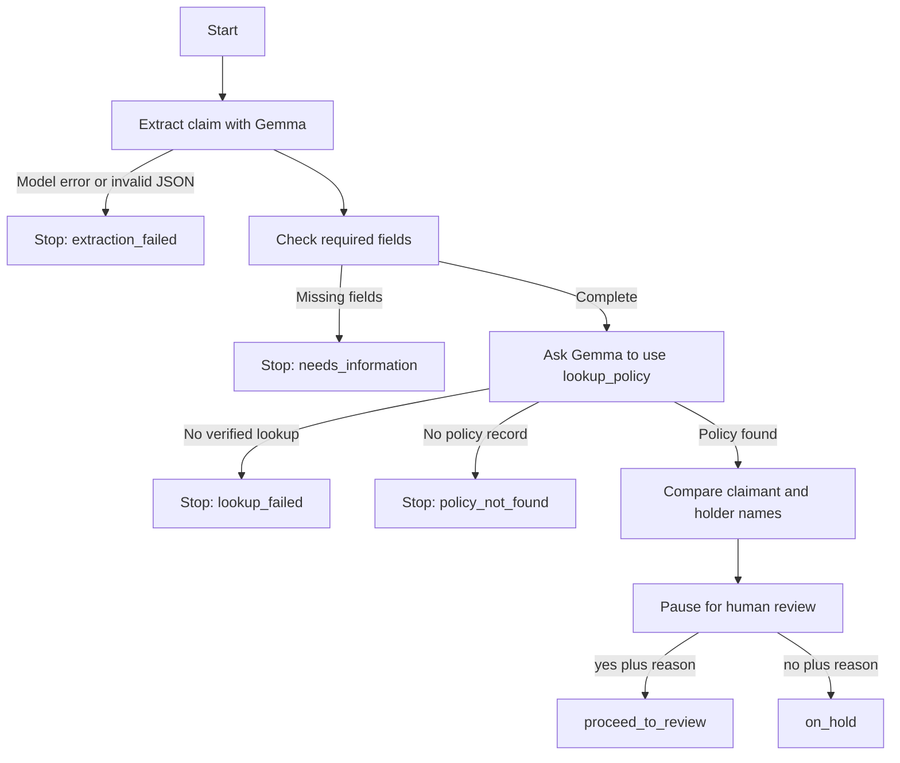

# Insurance claims agent

A small, fictional insurance claim intake project built with Python, uv, LangGraph, and a local Gemma model in LM Studio. It extracts claim details, checks required fields, looks up a fictional policy through a model-requested tool call, and pauses for a human response. A reviewer can resume the same claim with a decision and reason. It does not approve claims or determine coverage.

## Set up

1. Install Python 3.12+ and [uv](https://docs.astral.sh/uv/).
2. In LM Studio, load `gemma-4-e4b-it` and start the local server at `http://127.0.0.1:1234`.
3. From this directory, run `uv sync`.

The defaults can be changed with `LM_STUDIO_BASE_URL` (include `/v1`), `LM_STUDIO_MODEL`, and `CLAIMS_DB_PATH`. The default SQLite file is `intake.sqlite` in the current directory. It is ignored by Git.

## Try the full flow

```bash
uv run claims-agent intake --claim-id DEMO-001 --case active_policy
uv run claims-agent resume --claim-id DEMO-001 --decision yes --reason "Policy record and name reviewed"
```

The first command prints a human review request and checkpoints the graph. The second command uses the same claim ID and SQLite database to resume it. `yes` means *proceed to human review*, not approve or pay the claim.

Other useful cases:

```bash
uv run claims-agent intake --claim-id DEMO-002 --case missing_incident_date
uv run claims-agent intake --claim-id DEMO-003 --case inactive_policy
uv run claims-agent intake --claim-id DEMO-004 --case unknown_policy
uv run claims-agent intake --claim-id DEMO-005 --case name_mismatch
```

Use `--description "I am ..."` instead of `--case` for your own fictional description. Use a new claim ID for each intake. `--db path/to/file.sqlite` is available on both intake and resume; pass the same path to both commands.

## How the graph works



An inactive policy still reaches the human pause, with `policy_status: inactive` in the review request. A name mismatch also reaches that pause with `names_match: false`. The reviewer makes the next decision. The policy lookup result is matched to the requested policy number before it enters the claim state.

## Check the project

Offline tests exercise graph routes, tool validation, and reviewer resume without calling the model:

```bash
uv run pytest -q
```

Live evaluations call LM Studio and compare extraction and graph outcomes across six fictional cases:

```bash
uv run claims-agent eval
uv run claims-agent eval --case active_policy
```

The live checks can expose model variability; a failure is a prompt to inspect the printed field and trace. Run them while LM Studio is serving the configured model.

## Files

```text
src/insurance_claims_agent/
  cli.py              intake, resume, and eval commands
  intake_graph.py     extraction, graph routing, reviewer pause
  claim_graph.py      deterministic required-field check
  tool_graph.py       bounded Gemma/tool loop
  tools.py            validated lookup_policy execution
  policies.py         fictional policy records
  policy_adapter.py   verified tool-result extraction
  evaluation.py       live evaluation runner
  evaluation_cases.py
  config.py           local model and database settings
tests/                fast offline checks
examples/lessons/     earlier standalone learning steps
```

All names, policies, and claims in this repository are fictional. Use synthetic descriptions when recording or sharing a demo.
